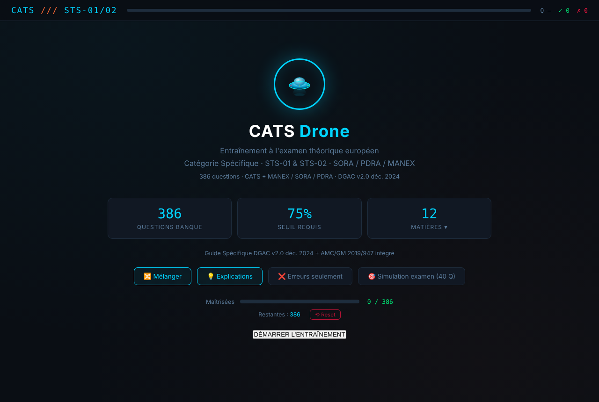

<!--
  Name     : README.md
  Purpose  : Overview of the quizz repository (courses, mock exams and tools in the browser)
  Author   : Eric PERRET
  Date     : 2026-10-17
  License  : CC BY 4.0
-->

# 🎓 Quizz — courses, exams and tools

🇫🇷 [Version française : LISEZMOI.md](LISEZMOI.md)

▶️ **[Home page of all the tools](https://ericperret.github.io/quizz/index2.html)**

A collection of standalone tools: one HTML file each, no library, no installation, they work offline. User interfaces in French (unless stated).

## Aviation and drones

| Tool | Launch | Content | Screenshot |
|---|---|---|---|
| CATS v8 | ▶️ [cats_quiz_v8.html](https://ericperret.github.io/quizz/cats_quiz_v8.html) | Training for the European drone theory exam, Specific category (STS-01, STS-02, SORA, PDRA, MANEX), 386 questions | [view](captures/cats_quiz_v8.png) |
| BAPD A2 | ▶️ [bapd_a2_v2.html](https://ericperret.github.io/quizz/bapd_a2_v2.html) | A2 mock exam (EASA AMC1 UAS.OPEN.030): 150+ questions, 30 drawn per exam, reinforcement (Q codes, TEMSI, METAR / TAF, airspace, fronts) | [view](captures/bapd_a2_v2.png) |
| Microlight theory | ▶️ [quiz_ulm.html](https://ericperret.github.io/quizz/quiz_ulm.html) | Training for the French microlight (ULM) theory exam, specialisation module | [view](captures/quiz_ulm.png) |
| Drone A1 / A3 course | ▶️ [cours_theorique_drone_A1A3.html](https://ericperret.github.io/quizz/cours_theorique_drone_A1A3.html) | Full course: regulations, distances, zones, pre-flight, human factors, safety | [view](captures/cours_theorique_drone_A1A3.png) |
| PDRA-G | ▶️ [pdra_g_recap.html](https://ericperret.github.io/quizz/pdra_g_recap.html) | Summary sheet of the PDRA-G01 to G03 scenarios (DSAC guide, EU regulation 2019/947) | [view](captures/pdra_g_recap.png) |
| METAR / TAF decoder | ▶️ [metar_decoder.html](https://ericperret.github.io/quizz/metar_decoder.html) | Fetch by ICAO code or manual entry, annotated decoding for the remote pilot | [view](captures/metar_decoder.png) |
| Clouds and fronts | ▶️ [cours_meteo_fronts.html](https://ericperret.github.io/quizz/cours_meteo_fronts.html) | Animated course: cloud sequence of warm, cold and occluded fronts | [view](captures/cours_meteo_fronts.png) |
| North and drift | ▶️ [nord_declinaison_derive.html](https://ericperret.github.io/quizz/nord_declinaison_derive.html) | True, magnetic and compass north; declination, deviation, drift | [view](captures/nord_declinaison_derive.png) |
| ATC light signals | ▶️ [signaux_lumineux_atc.html](https://ericperret.github.io/quizz/signaux_lumineux_atc.html) | Summary of SERA.3225 and ICAO Annex 2, in flight and on the ground, pyrotechnics | [view](captures/signaux_lumineux_atc.png) |
| Light aircraft comparison | ▶️ [aircraft_compare.html](https://ericperret.github.io/quizz/aircraft_compare.html) | Eagle 150B against competitors: efficiency, cost per hour, performance (fuel and maintenance prices adjustable) | [view](captures/aircraft_compare.png) |

## School

| Tool | Launch | Content | Screenshot |
|---|---|---|---|
| Défi Maths CM2 | ▶️ [defi-maths-cm2.html](https://ericperret.github.io/quizz/defi-maths-cm2.html) | Diagnostic maths assessment for year 6 (CM2), written operations | [view](captures/defi-maths-cm2.png) |
| Reading and spelling test | ▶️ [test_dyslexie_v4.html](https://ericperret.github.io/quizz/test_dyslexie_v4.html) | 10 tests for CM1 / CM2 to find where and why reading gets stuck | [view](captures/test_dyslexie_v4.png) |
| Remediation exercises | ▶️ [dyslexie_exo_v3.html](https://ericperret.github.io/quizz/dyslexie_exo_v3.html) | Adaptive training (flash, phonology, rapid automatised naming RAN), profiles, import from the test | [view](captures/dyslexie_exo_v3.png) |

## Health and wellbeing

| Tool | Launch | Content | Screenshot |
|---|---|---|---|
| Diagnostic self-orientation | ▶️ [quizz_2_5.html](https://ericperret.github.io/quizz/quizz_2_5.html) | Self-reflection questionnaire on emotional functioning, to prepare a discussion with a professional | [view](captures/quizz_2_5.png) |
| ⭐ Paediatric triage | ▶️ [triage-pediatrique.html](https://ericperret.github.io/quizz/triage-pediatrique.html) | Flagship tool, tested and approved by emergency physicians: parental observation aid, child aged 6 to 15; does not replace medical advice (emergency in France: 15 or 112) | [view](captures/triage-pediatrique.png) |
| Music and emotions | ▶️ [music-tpb-v2_3.html](https://ericperret.github.io/quizz/music-tpb-v2_3.html) | Music chosen from the felt state, ISO principle of music therapy | [view](captures/music-tpb-v2_3.png) |

These tools are aids to reflection, not medical devices. Critical review of the triage tool (French): [revue-clinique-de_triage-pediatrique_chagpt_gemini_gork.txt](revue-clinique-de_triage-pediatrique_chagpt_gemini_gork.txt). Report (French): [Quizz Rapport.pdf](<Quizz Rapport.pdf>) / [quizz rapport.rtf](<quizz rapport.rtf>).

## Games and tools

| Tool | Launch | Content | Screenshot |
|---|---|---|---|
| Blackjack | ▶️ [blackjack.html](https://ericperret.github.io/quizz/blackjack.html) | Bank against player: shoe, bets, double, split, insurance, auto mode | [view](captures/blackjack.png) |
| The Adjustment Bureau | ▶️ [lagence.html](https://ericperret.github.io/quizz/lagence.html) | Field operations manual, fiction inspired by the film (in English) | [view](captures/lagence.png) |
| Image → Base64 | ▶️ [image2b64.html](https://ericperret.github.io/quizz/image2b64.html) | Resize an image and export it as Base64 (text file) | [view](captures/image2b64.png) |

## History

| Version | Change |
|---|---|
| 2026-10-17 | Complete home page (19 tools instead of 4, grouped by topic), header blocks added, README / LISEZMOI rewritten from the actual content, screenshot of every tool |

## License

[CC BY 4.0](https://creativecommons.org/licenses/by/4.0/)

## Author

**Eric PERRET** — [GitHub](https://github.com/ericperret)
